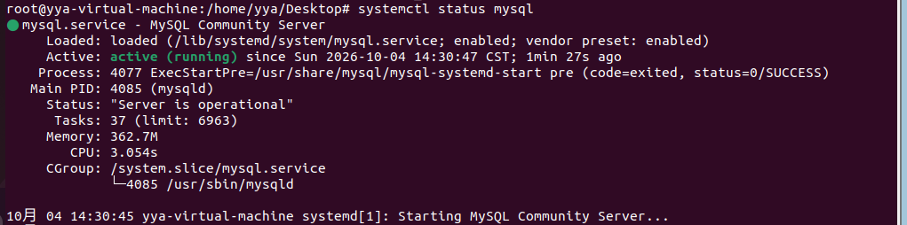
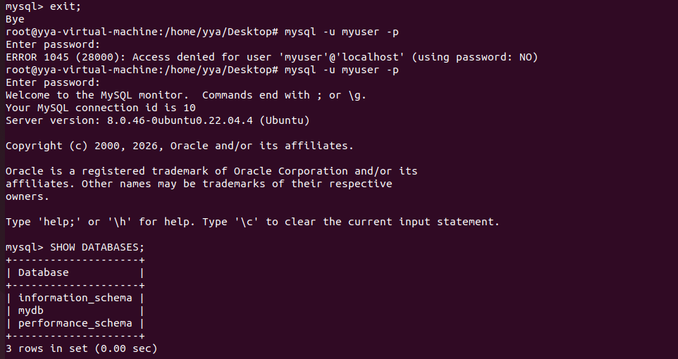
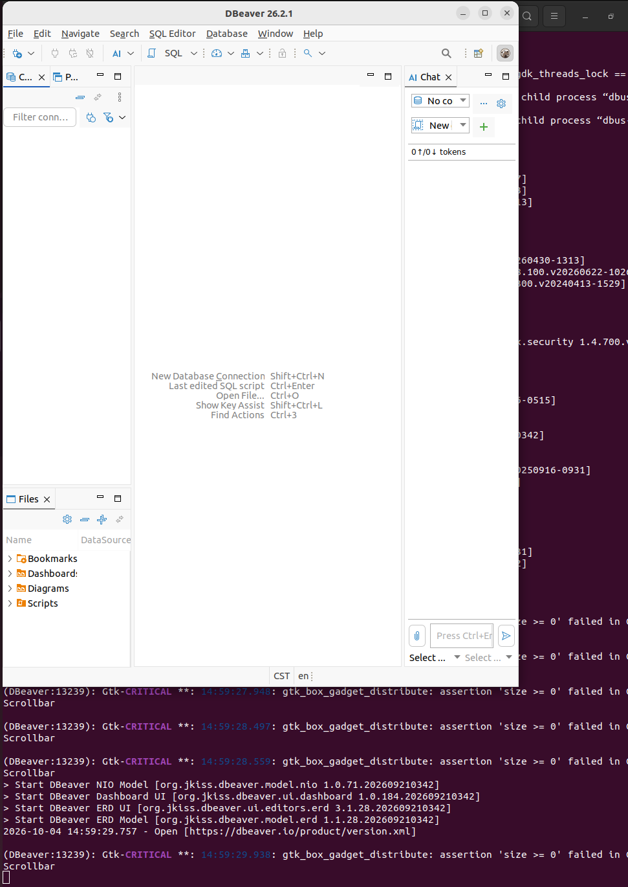
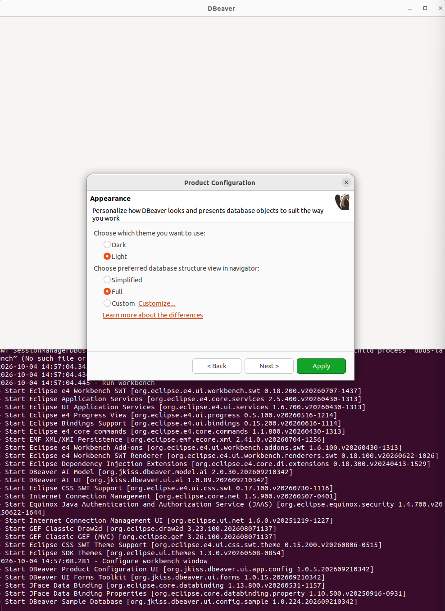
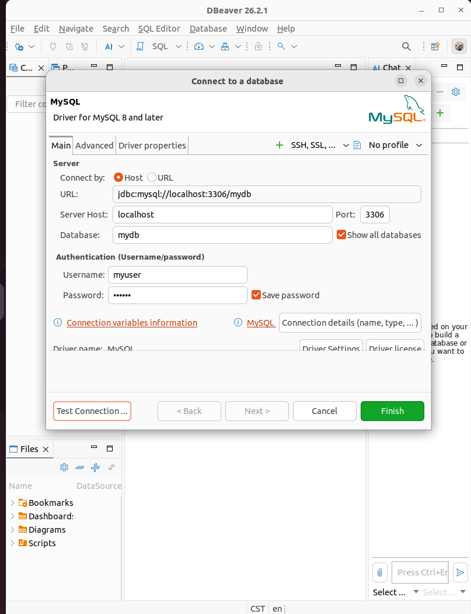
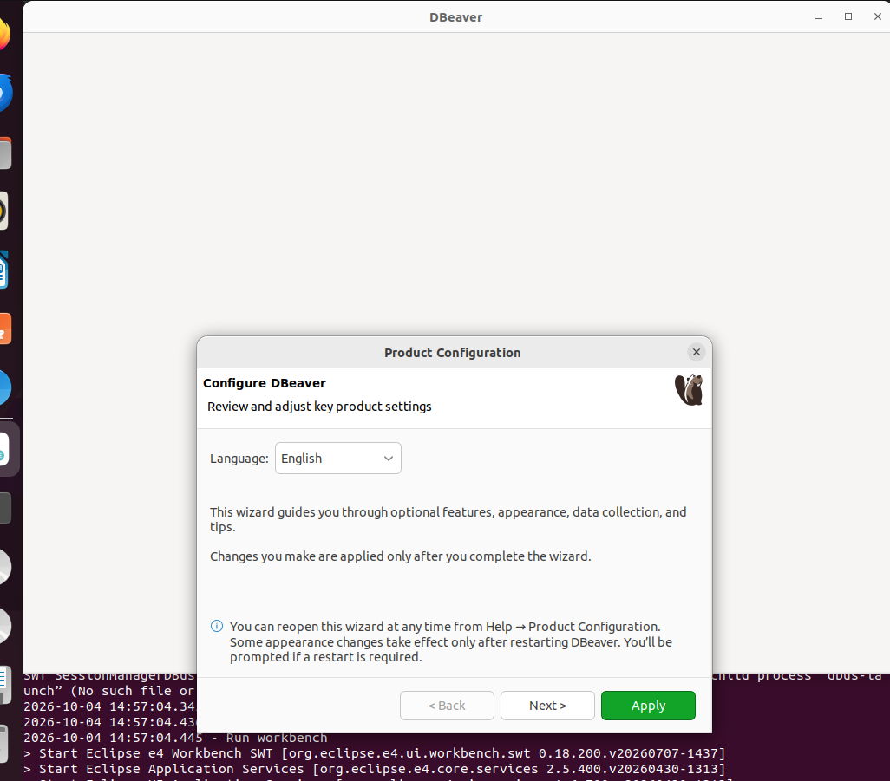
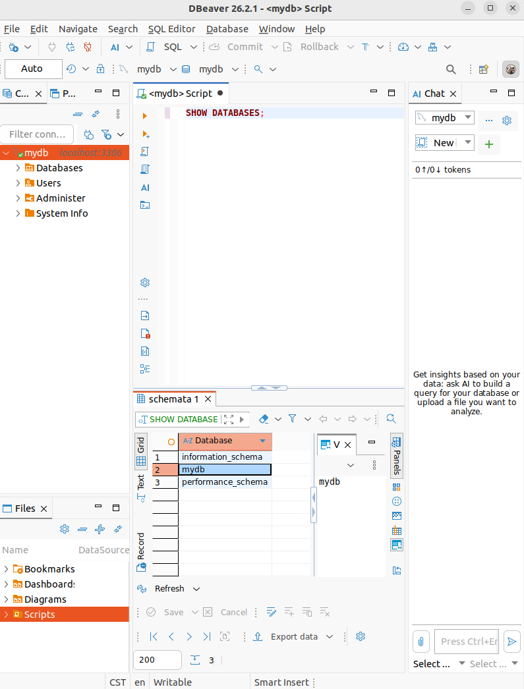

# MySQL服务器搭建实验报告

## 一、实验基本信息

- 姓名：闫雪雅
- 学号：B24040203
- 实验名称：搭建 MySQL 服务器
- 实验环境：Ubuntu 22.04
- 数据库：MySQL 8.0.46
- 数据库管理工具：DBeaver 26.2.1

---

## 二、实验目的

1. 掌握在 Ubuntu 系统中安装 MySQL Server 的方法。
2. 掌握 MySQL 服务的启动及运行状态查看方法。
3. 学会创建 MySQL 数据库和数据库用户。
4. 掌握数据库用户权限的配置方法。
5. 学会使用 DBeaver 图形化数据库管理工具连接 MySQL 数据库。
6. 熟悉 Linux 环境下数据库服务器的基本配置流程。

---

## 三、实验环境

本次实验使用 Ubuntu 22.04 虚拟机完成 MySQL 数据库服务器的搭建。

主要软件环境如下：

| 软件 | 版本 |
| --- | --- |
| Ubuntu | 22.04 |
| MySQL Server | 8.0.46 |
| DBeaver | 26.2.1 |
| MySQL Connector/J | 8.2.0 |

---

## 四、实验过程

### 1. 切换到 root 用户

打开 Ubuntu 终端，输入以下命令切换到 root 用户：

```bash
sudo su root
```

成功切换后，终端提示符变为：

```text
root@yya-virtual-machine:/home/yya/Desktop#
```

使用 root 用户可以方便地完成软件安装以及服务管理等操作。

---

### 2. 安装 MySQL Server

首先更新 Ubuntu 软件包列表：

```bash
apt update
```

然后安装 MySQL Server：

```bash
apt install mysql-server -y
```

安装完成后，使用以下命令查看 MySQL 版本：

```bash
mysql --version
```

系统显示：

```text
mysql  Ver 8.0.46-0ubuntu0.22.04.4 for Linux on x86_64 ((Ubuntu))
```

说明 MySQL 已成功安装。

---

### 3. 查看 MySQL 服务状态

输入：

```bash
systemctl status mysql
```

运行结果中显示：

```text
Active: active (running)
Status: "Server is operational"
```

说明 MySQL 服务已经正常启动，并处于运行状态。

实验中的 MySQL 服务主要信息如下：

```text
mysql.service - MySQL Community Server
Loaded: loaded
Active: active (running)
Status: "Server is operational"
```

因此 MySQL 数据库服务器已经成功运行。

---

### 4. 进入 MySQL

在终端输入：

```bash
mysql
```

成功进入 MySQL 后显示：

```text
Welcome to the MySQL monitor.
Server version: 8.0.46-0ubuntu0.22.04.4 (Ubuntu)
```

并出现：

```text
mysql>
```

提示符，说明已经进入 MySQL 命令行环境。

---

### 5. 创建数据库

在 MySQL 中创建名为 `mydb` 的数据库：

```sql
CREATE DATABASE mydb CHARACTER SET utf8mb4 COLLATE utf8mb4_unicode_ci;
```

其中：

- `mydb` 为数据库名称；
- `utf8mb4` 为数据库字符集；
- `utf8mb4_unicode_ci` 为字符排序规则。

使用 UTF-8 字符集可以较好地支持中文等多语言字符。

---

### 6. 创建数据库用户

创建一个新的 MySQL 用户：

```sql
CREATE USER 'myuser'@'localhost' IDENTIFIED BY '111111';
```

本实验设置：

```text
用户名：myuser
密码：111111
访问主机：localhost
```

其中 `localhost` 表示该用户从本机连接 MySQL 数据库。

---

### 7. 为用户分配数据库权限

将 `mydb` 数据库的全部权限授予 `myuser`：

```sql
GRANT ALL PRIVILEGES ON mydb.* TO 'myuser'@'localhost';
```

随后刷新 MySQL 权限：

```sql
FLUSH PRIVILEGES;
```

这样 `myuser` 用户即可对 `mydb` 数据库进行相关操作。

---

### 8. 查看数据库

输入：

```sql
SHOW DATABASES;
```

在数据库列表中可以看到：

```text
mydb
```

说明数据库创建成功。

完成后退出 MySQL：

```sql
exit;
```

---

### 9. 测试新建用户

为了验证刚刚创建的用户和权限是否正常，在 Ubuntu 终端输入：

```bash
mysql -u myuser -p
```

系统提示：

```text
Enter password:
```

输入设置的密码：

```text
111111
```

成功进入 MySQL 后再次执行：

```sql
SHOW DATABASES;
```

可以正常看到 `mydb` 数据库，说明 `myuser` 用户创建成功，同时数据库权限配置正确。

随后输入：

```sql
exit;
```

退出 MySQL。

---

## 五、安装 DBeaver 数据库管理工具

### 1. 使用 Snap 安装

最初按照实验要求尝试使用以下命令安装 DBeaver：

```bash
snap install dbeaver-ce --classic
```

安装过程中 DBeaver 下载失败。

使用：

```bash
snap changes
```

查看任务状态，发现：

```text
Error  Install "dbeaver-ce" snap
```

进一步执行：

```bash
snap tasks 7
```

发现错误信息：

```text
ERROR Get "https://api.snapcraft.io/...":
dial tcp 185.125.188.58:443: connect: connection refused
```

说明 Ubuntu 虚拟机无法正常连接 Snap 软件源的 HTTPS 服务器，因此 DBeaver 无法通过 Snap 正常下载。

---

### 2. 更换安装方式

由于 Snap 网络连接出现问题，因此改用 DBeaver 的 Linux 安装包进行安装。

安装完成后成功启动 DBeaver。

启动界面显示 DBeaver 版本为：

```text
DBeaver 26.2.1
```

说明数据库图形化管理软件安装成功。

---

## 六、使用 DBeaver 连接 MySQL

打开 DBeaver 后，新建 MySQL 数据库连接。

连接参数设置如下：

| 配置项 | 内容 |
| --- | --- |
| Server Host | localhost |
| Port | 3306 |
| Database | mydb |
| Username | myuser |
| Password | 111111 |

配置完成后点击：

```text
Test Connection
```

第一次连接时，DBeaver 自动下载 MySQL JDBC 驱动。

使用的驱动为：

```text
MySQL Connector/J 8.2.0
```

连接日志中出现：

```text
Connected to a datasource
databaseProductName='MySQL'
databaseProductVersion='8.0.46-0ubuntu0.22.04.4'
driverName='MySQL Connector/J'
```

说明 DBeaver 已经成功连接到本机 MySQL 数据库服务器。

随后点击 `Finish` 保存数据库连接。

---

## 七、数据库连接验证

在 DBeaver 中连接数据库后，可以在 Database Navigator 中查看 MySQL 数据库。

为了进一步验证数据库是否连接成功，可以打开 SQL Editor，执行：

```sql
SHOW DATABASES;
```

查询结果中能够看到：

```text
mydb
```

说明 DBeaver 已经能够正常访问之前创建的 MySQL 数据库。

至此，MySQL 数据库服务器搭建、数据库创建、用户权限配置以及 DBeaver 图形化连接全部完成。

---

## 八、实验过程中遇到的问题及解决方法

### 问题1：在 MySQL 中误输入 Linux 命令

实验过程中进入 MySQL 后，曾直接输入：

```text
snap install dbeaver-ce --classic
```

由于当前提示符为：

```text
mysql>
```

因此 MySQL 将其当成 SQL 语句处理，并不断出现：

```text
->
```

### 解决方法

首先使用：

```text
Ctrl + C
```

取消当前输入，然后执行：

```sql
exit;
```

退出 MySQL。

确认终端提示符恢复为：

```text
root@yya-virtual-machine:#
```

之后再执行 Linux 命令。

通过该问题进一步理解了：

```text
mysql>
```

表示当前处于 MySQL 环境，而：

```text
root@...#
```

或者：

```text
yya@...$
```

表示当前处于 Linux Shell 环境。

---

### 问题2：Snap 无法下载 DBeaver

使用：

```bash
snap install dbeaver-ce --classic
```

安装 DBeaver 时出现网络连接错误：

```text
dial tcp 185.125.188.58:443: connect: connection refused
```

说明虚拟机无法连接 Snapcraft 下载服务器。

### 解决方法

通过：

```bash
snap changes
```

和：

```bash
snap tasks 7
```

定位具体错误，确认问题来自 Snap 网络连接，而不是 MySQL 或 DBeaver 配置错误。

随后更换 DBeaver 安装方式，最终成功启动 DBeaver。

---

### 问题3：DBeaver 启动时出现 GTK 警告

DBeaver 启动时终端出现：

```text
Gtk-CRITICAL
gtk_box_gadget_distribute
Scrollbar
```

但是 DBeaver 图形界面仍能正常打开，MySQL JDBC 驱动能够正常加载，并且数据库能够成功连接。

因此判断该信息属于图形界面相关警告，对本次数据库实验没有实际影响。

---

## 九、实验结果

本次实验最终成功完成以下内容：

1. 在 Ubuntu 22.04 中成功安装 MySQL Server。
2. MySQL 服务正常运行，状态为 `active (running)`。
3. 成功创建数据库 `mydb`。
4. 成功创建数据库用户 `myuser`。
5. 成功为 `myuser` 分配 `mydb` 数据库访问权限。
6. 使用 `myuser` 用户成功登录 MySQL。
7. 成功安装并运行 DBeaver。
8. 成功下载并加载 MySQL Connector/J 数据库驱动。
9. DBeaver 成功连接 MySQL 8.0.46 数据库服务器。
10. 能够通过图形化数据库管理工具查看和管理 `mydb` 数据库。

---

## 十、实验截图

### 1. MySQL 服务成功运行



### 2. MySQL 数据库相关信息



### 3. DBeaver 启动界面



### 4. DBeaver 数据库连接设置



### 5. DBeaver 其他设置



### 6. DBeaver 连接 MySQL



### 7. 最终实验结果


## 十一、实验总结

通过本次实验，我完成了 Ubuntu 环境下 MySQL 数据库服务器的安装和基本配置，掌握了使用 `systemctl` 查看数据库服务状态的方法，同时学习了 MySQL 数据库、用户以及用户权限的创建与管理。

在配置过程中，我进一步理解了 Linux Shell 命令和 MySQL SQL 命令的区别，并通过实际排查解决了 Snap 软件源网络连接失败的问题。

最后使用 DBeaver 成功连接 MySQL 数据库，使数据库可以通过图形化界面进行管理。通过本次实验，我对 Linux 环境下数据库服务器的安装、配置、权限管理以及客户端连接流程有了更加完整的认识。